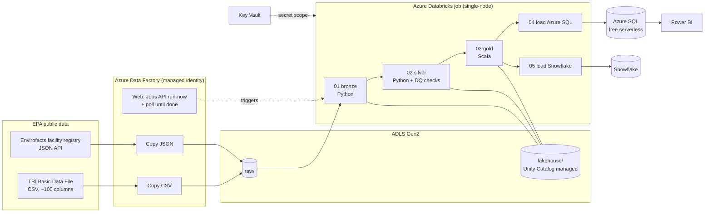

# TRI Lakehouse: EPA chemical-release data on Azure

An end-to-end Azure data pipeline over the EPA **Toxics Release Inventory (TRI)**, the
federal dataset of how much of each toxic chemical every U.S. industrial facility releases
to air, water and land each year.

**Azure Data Factory** ingests two public EPA sources into **ADLS Gen2**. **Databricks**
curates them through bronze → silver → gold Delta tables (Python + Scala). Gold tables are
served from **Azure SQL** (and optionally **Snowflake**) to **Power BI**. All infrastructure
is code (**Terraform + Bicep**), and every service-to-service hop uses a **managed identity**
or **Key Vault**, never a password in code.



| Layer | Table(s) | What happens |
|---|---|---|
| Raw | `raw/tri/releases/reporting_year=YYYY/ingest_date=…/`, `raw/tri/facilities/ingest_date=…/` | ADF lands source bytes untouched (binary copy) |
| Bronze | `bronze.tri_releases`, `bronze.tri_facilities` | Same data as Delta, Delta-safe column names, ingestion metadata |
| Silver | `silver.tri_releases`, `silver.tri_facilities`, `silver.dq_metrics` | ~30 typed columns, grams→pounds, YES/NO→boolean, one row per reporting form, DQ metrics per run |
| Gold | `facility_releases`, `chemical_state_releases`, `parent_company_releases`, `data_quality` | Aggregates for reporting, source-system reconciliation |
| Serving | Azure SQL `dbo.gold_*` + views, Snowflake `TRI_DB.GOLD.*` | Power BI imports from Azure SQL |

---

## Repo layout

```
infra/terraform/platform/    RG, ADLS, Key Vault, ADF, Databricks workspace + access connector, SQL server, RBAC, budget
infra/terraform/databricks/  Unity Catalog credential/locations/catalog/schemas, KV-backed secret scope, notebooks, job, ADF permissions
infra/bicep/                 Azure SQL database (free offer) + ADF linked services, datasets, pipeline, trigger
databricks/notebooks/        01 bronze, 02 silver (Python) · 03 gold (Scala) · 04 Azure SQL, 05 Snowflake · tri_transforms.py · azure_sql_views.sql
tests/                       pytest for the Python transforms + a spark-shell test of the Scala gold logic
scripts/                     Deploy-All · Start-Pipeline · Test-Sources · New-SnowflakeKeyPair · Remove-All (PowerShell 7)
snowflake/                   setup / sample queries / teardown SQL
docs/powerbi.md              report build guide
```

---

## Design decisions

These are the choices an interviewer is likely to ask about.

* **ADF orchestrates, Databricks transforms.** ADF is good at moving bytes from HTTP sources
  and scheduling. Databricks is good at code-first, testable transformations. ADF lands files
  as **binary copies**, so parsing logic lives in one tested place (silver), not in ADF mappings.
* **Two source systems, reconciled.** Releases come from the TRI Basic Data File (CSV). The
  facility registry comes from the Envirofacts API (JSON). `gold.data_quality.registry_match_rate`
  measures how many reporting facilities exist in the registry.
* **Medallion layers + idempotency.** Each run writes only its own reporting year
  (`replaceWhere`). Silver keeps one row per reporting form (`doc_ctrl_num`, latest ingest wins).
  Re-running the pipeline never duplicates data.
* **Schema-drift tolerance.** EPA header formats vary (`1. YEAR` vs `YEAR`, en dash vs hyphen).
  Bronze normalizes names; silver maps each target column from a list of known aliases, and
  **fails loudly** listing the available columns if a required one disappears.
* **Unit normalization.** Dioxins are reported in grams and everything else in pounds. Silver
  converts all quantities to `*_lb`, so sums across chemicals are valid.
* **Data-quality gates.** Every run appends metrics to `silver.dq_metrics`. The job fails
  (and so does ADF) if silver is empty or more than 5% of totals don't parse.
* **No secrets in code.**
  * ADF → ADLS: managed identity (RBAC).
  * ADF → Databricks: managed identity, registered as a workspace service principal with
    **CAN_MANAGE_RUN on this one job only**.
  * Databricks → ADLS: **Unity Catalog storage credential** backed by an Access Connector's
    managed identity.
  * Databricks → Azure SQL / Snowflake: credentials read from a **Key Vault-backed secret scope**.
* **Terraform + Bicep split.** Terraform owns the long-lived platform and the Databricks
  objects (one tool, two providers). Bicep owns the ARM-native pipeline layer (ADF pipeline
  JSON, SQL database), which changes more often and maps 1:1 to ADF's own ARM definitions.
* **ADF → Databricks via the Jobs API, not the native activity.** The ADF Databricks *Job*
  activity is still in preview. A Web activity (`run-now`) plus an Until loop on `runs/get` is
  GA, passes job parameters reliably, and surfaces the Databricks run URL on failure.
* **Scala for gold.** The aggregations are typed Spark Scala (`GoldTransforms` object), tested
  locally in `spark-shell`.
* **Snowflake** uses a `TYPE = SERVICE` user with **key-pair auth**: Snowflake no longer allows
  password-only sign-in for service users. A resource monitor caps spend.
* **Cost controls.**
  * Databricks trial tier, with a single-node job cluster that exists only while the job runs.
  * Azure SQL free serverless offer (auto-pauses, so the JDBC `loginTimeout` is 90 s).
  * Snowflake XS warehouse with 60 s auto-suspend.
  * Azure budget alerts.
* **Known trade-off.** Azure SQL allows "Azure services" through its firewall, because
  Databricks classic compute has no fixed egress IP. Production would use VNet injection and
  Private Endpoints.

---

## Prerequisites

1. **Azure for Students**: <https://azure.microsoft.com/free/students> (sign up with your
   illinois.edu account; $100 credit, no card).
2. Install on your laptop:
   * [Azure CLI](https://learn.microsoft.com/cli/azure/install-azure-cli) (includes Bicep via `az bicep install`)
   * [Terraform](https://developer.hashicorp.com/terraform/install) ≥ 1.6
   * [PowerShell 7](https://learn.microsoft.com/powershell/scripting/install/installing-powershell) (`pwsh`), on Windows, macOS or Linux
   * openssl (macOS/Linux built-in; Windows: comes with Git for Windows). Needed only for Snowflake.
3. Optional: **Snowflake 30-day trial**: <https://signup.snowflake.com> (any cloud/region; pick Azure for symmetry).

---

## Deploy, step by step

All commands run from the repo root in `pwsh`.

### 0. Check the EPA sources (2 min, before spending anything)

```powershell
./scripts/Test-Sources.ps1 -ReportingYear 2024
```

You should see `Status 200` for both and `OK` next to YEAR, TRIFD, CHEMICAL, TOTAL RELEASES.
If a URL has moved, the script prints how to find the new one. It's a pipeline parameter, so
no code change is needed.

### 1. Sign in and pick an allowed region

```powershell
az login
az account show --query "{name:name, id:id}" -o table
# Azure for Students limits regions by policy. List the ones you're allowed:
az policy assignment list --query "[].parameters.listOfAllowedLocations.value" -o json
# Check VM quota for the Databricks node family (need 4 vCPUs of DSv2):
az vm list-usage -l centralus -o table | Select-String "DSv2|Total Regional"
```

Pick a region that is both allowed and has quota; use it for `-Location` below.

### 2. (Optional) Snowflake

```powershell
./scripts/New-SnowflakeKeyPair.ps1
```

1. In Snowsight, open a worksheet, paste `snowflake/setup.sql`, and replace
   `PASTE_PUBLIC_KEY_BODY_HERE` with the key the script printed. Run it.
2. Note the `account_url` printed by the last query.

### 3. Deploy everything (~15 min)

```powershell
./scripts/Deploy-All.ps1 `
    -SubscriptionId (az account show --query id -o tsv) `
    -Location centralus `
    -AlertEmail schin68@illinois.edu
```

With Snowflake, add:

```powershell
    -EnableSnowflake -SnowflakeAccountUrl <account_url> `
    -SnowflakePrivateKeyPath ./.secrets/snowflake_rsa_key.p8
```

Then delete `./.secrets/snowflake_rsa_key.p8`; the key now lives only in Key Vault.

### 4. Run the pipeline (~15–25 min; most of it is cluster start-up)

```powershell
./scripts/Start-Pipeline.ps1 -ReportingYear 2024
```

Watch it in **ADF Studio → Monitor** and in **Databricks → Workflows → tri-lakehouse-pipeline**.
Load more years by re-running with `-ReportingYear 2023`, `2022`, …; gold recomputes across all of them.

### 5. Verify

In Databricks (**SQL Editor** or a notebook):

```sql
SELECT * FROM tri_lakehouse.gold.data_quality;
SELECT metric, value FROM tri_lakehouse.silver.dq_metrics ORDER BY run_ts DESC LIMIT 20;
SELECT * FROM tri_lakehouse.gold.parent_company_releases WHERE reporting_year = 2024 ORDER BY rank_in_year LIMIT 10;
```

In Azure SQL (Portal → database → Query editor, sign in with Entra):

```sql
SELECT TOP 10 * FROM dbo.vw_parent_company_top25 ORDER BY reporting_year DESC, rank_in_year;
SELECT * FROM dbo.vw_dow_facilities;
```

### 6. Power BI

See [docs/powerbi.md](docs/powerbi.md).

### 7. Tear down when you're done

```powershell
./scripts/Remove-All.ps1
```

Run `snowflake/teardown.sql` if you used Snowflake.

---

## Run the tests locally

```powershell
python -m venv .venv; ./.venv/bin/pip install pyspark==4.0.1 pytest    # Windows: .\.venv\Scripts\pip
./.venv/bin/python -m pytest -q tests
```

The tests need Java 17 or 21. `test_gold_scala.py` runs the Scala gold notebook's
`GoldTransforms` in the `spark-shell` bundled with PySpark.

---

## Cost (Azure for Students $100 credit)

| Service | What drives cost | Expect |
|---|---|---|
| Databricks | VM time while the job cluster runs (DBUs free during the 14-day trial) | cents–~$1 per run |
| Data Factory | activity runs + copy DIU-minutes | cents per run |
| Azure SQL | free offer (100k vCore-seconds/month); pauses when exhausted | $0 |
| ADLS, Key Vault | a few hundred MB, a handful of secret reads | cents/month |
| Snowflake | trial credits; XS warehouse, 60 s auto-suspend, 5-credit monitor | $0 during trial |

**Don't leave an all-purpose (interactive) cluster running.** The job's cluster shuts down by
itself; clusters you create by hand don't unless you set auto-termination. After the trial,
Databricks bills Premium DBUs, so run `Remove-All.ps1` when you're done.

---

## Troubleshooting

| Symptom | Fix |
|---|---|
| `RequestDisallowedByPolicy` on deploy | Region not allowed for your subscription. Re-run step 1, pick another region, delete `infra/terraform/*/terraform.tfstate*`, deploy again. |
| `azuread_service_principal` data source: insufficient privileges | Your university tenant blocks directory reads. Look up the IDs in Portal → Entra ID → Enterprise applications ("AzureDatabricks", and your data factory's name) and hard-code them in place of the two data sources. |
| Databricks cluster fails: quota / `QuotaExceeded` | Request 4 vCPUs for the VM family (Portal → Subscriptions → Usage + quotas), or pass `-NodeType` with a family you have quota for. |
| `databricks_storage_credential` fails: no metastore / permission denied | The workspace isn't Unity Catalog-enabled. In Databricks run `SELECT CURRENT_METASTORE()`. Your university tenant's Databricks account may control metastore assignment; ask, or deploy to another region. |
| Catalog name already exists | Unity Catalog metastores are shared per region within a tenant. Set `catalog_name` (Databricks stage variable) to something unique. |
| `databricks_service_principal` fails | Fallback: grant ADF's identity *Contributor* on the Databricks workspace resource (it's then auto-admitted on first call). Tighter scoping is the reason for the default. |
| ADF Copy fails 404 / timeout | EPA URL moved or was slow. Run `Test-Sources.ps1`, then change the pipeline parameters in ADF Studio. |
| Silver fails "missing required columns" | The error lists the columns it found. Add the new name to the candidate list in `tri_transforms.py`, run the tests, and `terraform apply` the Databricks stage. |
| JDBC login timeout to Azure SQL | The database was resuming from auto-pause; re-run the task. |
| Snowflake `JWT token is invalid` | Public key mismatch: rerun `ALTER USER … SET RSA_PUBLIC_KEY` with the key from the same pair stored in Key Vault. |
